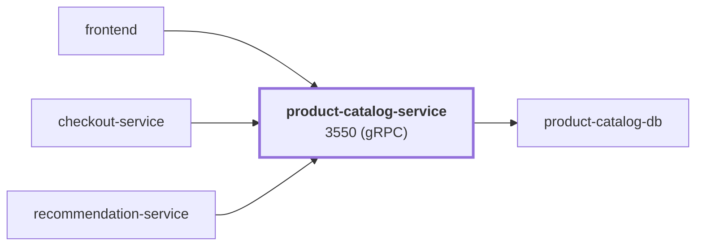

# product-catalog-service

service · platform-demo

A gRPC service that exposes the product catalog for the platform-demo e-commerce platform. It loads all products from PostgreSQL (`product-catalog-db`) into memory at startup and serves reads from that in-memory copy. It is the most widely used read service in the system — `frontend`, `checkout-service` and `recommendation-service` all call it.

Runtime<strong>Go 1.25</strong><small>Go</small>

Listens on<strong>3550</strong><small>gRPC</small>

State<strong>Stateless</strong>

Image<strong>product-catalog-service</strong><small>mladenovskistefan/</small>

## Where it sits

Called by `frontend`, `checkout-service`, `recommendation-service`. It calls `product-catalog-db`.

## At a glance

| | |
|---|---|
| **Language / runtime** | Go 1.25 (static binary, `CGO_ENABLED=0`), `pgx/v5` |
| **Image** | `mladenovskistefan/product-catalog-service` |
| **Protocol / port** | gRPC (HTTP/2, plaintext) on `3550` |
| **Metrics** | Pushed over OTLP/gRPC (Prometheus registry bridged into OpenTelemetry); `/metrics` on `9090` is still served for debugging |
| **Health** | Standard `grpc.health.v1.Health/Check` on `3550` — static `SERVING`, does **not** reflect DB health |
| **State** | In-memory copy of the `products` table; source of truth is Postgres |
| **Depends on** | `product-catalog-db` (PostgreSQL) — **hard dependency at startup** |
| **Called by** | `frontend`, `checkout-service`, `recommendation-service` |
| **gRPC reflection** | Enabled — `grpcurl` works without `-proto` |

## Find it elsewhere

<h4><a href="https://argocd.platform-demo.test/applications/argocd/dev-product-catalog-service">Argo CD</a></h4>
Sync and health of <code>dev-product-catalog-service</code>.

<h4><a href="https://grafana.platform-demo.test/d/product-catalog-overview">Grafana</a></h4>
Latency, traffic and errors (<code>product-catalog-overview</code>).

<h4><a href="https://github.com/platform-boutique/app-product-catalog-service">Repository</a></h4>
Source, pull requests and releases of <code>app-product-catalog-service</code>.

!!! info "Part of the platform-demo platform"
    Cross-cutting facts (service wiring, observability contract, Kubernetes translation, CI/CD) are in the
    [master reference](https://github.com/platform-boutique/platform-demo-docs). This site only describes product-catalog-service.
